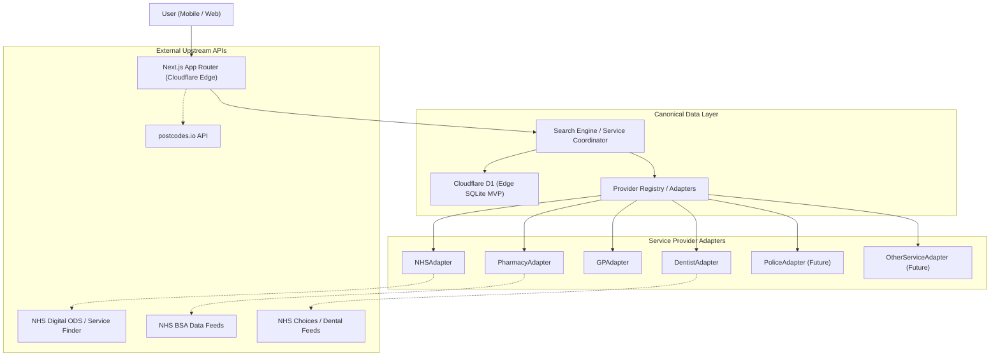

# NearbyAid — System Architecture

**Domain:** `nearbyaid.co.uk`  
**Stack:** Next.js (App Router), TypeScript, Tailwind CSS, Cloudflare (Pages / D1)

---

## 1. Architectural Philosophy

NearbyAid is built upon a fundamental architectural requirement:

> **External data providers must be replaceable without altering the application core or user interface.**

Authoritative public data in the UK changes frequently. API endpoints change, rate limits adjust, government bodies rebrand, and regional differences exist between England, Wales, Scotland, and Northern Ireland. 

To future-proof NearbyAid:
- The user interface and domain logic interact **only with canonical NearbyAid domain models**.
- All external data sources communicate through an **Adapter / Data-Provider layer**.
- The core search engine queries our canonical store or provider adapters uniformly.



---

## 2. Technical Stack Breakdown

### Frontend
- **Framework:** Next.js (App Router, Server Components + selective Client Components)
- **Language:** TypeScript (strict mode enabled)
- **Styling:** Tailwind CSS (high-contrast accessible tokens, mobile-first responsive utilities)
- **State & Location:** Browser Geolocation API + URL search parameters for clean, bookmarkable search results

### Hosting & Infrastructure
- **Platform:** Cloudflare (Cloudflare Pages / Workers runtime)
- **Edge Routing:** Low-latency UK regional edge resolution
- **Static Assets:** Cloudflare Global CDN

### Database (MVP)
- **Engine:** Cloudflare D1 (serverless SQLite at the edge)
- **Data Model:** Normalized tables for service entities, categories, geocoordinates, contacts, and opening schedules
- **Spatial Search:** Haversine formula calculation at query time or indexed bounding-box spatial queries

### Source Control
- **Platform:** GitHub
- **Repository:** `nearby-aid`
- **Main Branch:** `main`

---

## 3. The Adapter / Data-Provider Architecture

Every service category or upstream source implements a common provider interface:

```typescript
// Canonical Interface Contract (Concept)
export interface ServiceProvider<T = ServiceEntity> {
  readonly id: string;
  readonly category: ServiceCategory;
  
  searchNearby(options: SearchNearbyOptions): Promise<SearchResult<T>>;
  getById(id: string): Promise<T | null>;
  verifyEmergencyStatus?(id: string): Promise<VerificationStatus>;
}
```

### Planned Adapters (Phased Implementation)
1. **`NHSAdapter`:** Ingests and queries NHS England ODS data for hospitals and urgent treatment centres.
2. **`PharmacyAdapter`:** Ingests pharmacy datasets (NHS BSA / ODS).
3. **`GPAdapter`:** Manages GP practices and primary care network listings.
4. **`DentistAdapter`:** Manages NHS and urgent dental access services.
5. **`PoliceAdapter` (Phase 15):** Police stations and public contact points via `data.police.uk`.
6. **`OtherServiceAdapter` (Phase 15):** Generic adapter for public defibrillators, community mental health hubs, and support centres.

---

## 4. Directory & Code Organization

```text
nearby-aid/
├── docs/                     # Comprehensive architectural & project documentation
│   ├── ARCHITECTURE.md
│   ├── DATA-SOURCES.md
│   ├── PROJECT.md
│   └── ROADMAP.md
├── src/
│   ├── app/                  # Next.js App Router (pages, layouts, route handlers)
│   │   ├── layout.tsx
│   │   ├── page.tsx
│   │   └── globals.css
│   ├── components/           # Reusable UI components (Phases 1+)
│   │   ├── ui/               # Primitives (Button, Input, Badge, EmergencyBanner)
│   │   └── services/         # Service cards, lists, category filters
│   ├── lib/                  # Core library and utility modules
│   │   ├── config/           # Site constants, disclaimers, category definitions
│   │   ├── geocoding/        # Postcode validation and postcodes.io client
│   │   └── providers/        # Adapter contracts and provider implementations
│   └── types/                # Canonical TypeScript definitions
│       ├── service.ts        # Canonical service, category, and opening hours models
│       ├── provider.ts       # Adapter interface contracts
│       └── location.ts       # Coordinate, postcode, and spatial query types
├── .env.example              # Environment variables template
├── .gitignore                # Production gitignore
├── package.json              # Project dependencies and scripts
└── tsconfig.json             # TypeScript configuration
```

---

## 5. Security & Safety Architectural Guarantees

1. **No Sensitive PII Collection:** Searches require only a UK postcode or coarse browser coordinates. No names, symptoms, medical queries, or user profiles are recorded.
2. **Zero-Trust A&E Badging:** No facility may display an "A&E" badge unless its verified classification is explicitly Type 1 or Type 2 Major Emergency Department.
3. **Static Disclaimers:** All service views include prominent disclaimers regarding independent status and emergency call (999) instructions.
